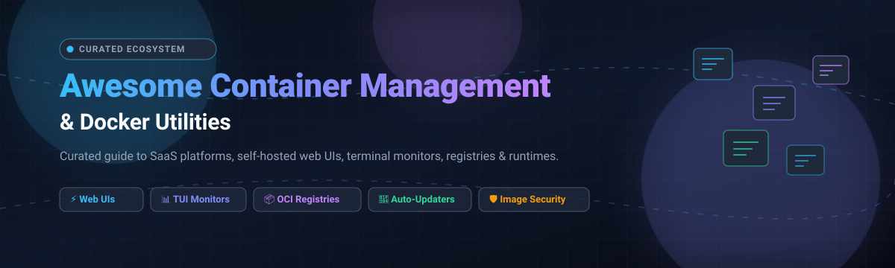

# Awesome Container Management & Docker Utilities 🐳 📦

  

  
  
  
  
  
  

---

## 🧭 Executive Summary & SEO Guide

**Awesome Container Management & Docker Utilities** is an authoritative, community-curated directory indexing the world's leading **SaaS / hosted cloud platforms** and **open-source GitHub utilities** for Docker, Podman, Kubernetes, and Open Container Initiative (OCI) workflows. 

Whether you are orchestrating enterprise production clusters across hybrid clouds, operating a high-availability homelab server, or optimizing local developer container builds, this list covers:
* 🌐 **Web UIs & Dashboards:** Portainer, Dockge, Coolify, Yacht, Komodo
* 💻 **Terminal User Interfaces (TUIs) & CLI Tools:** Lazydocker, Dive, Skopeo
* 🛡️ **Container Security & CVE Scanners:** Trivy, Docker Scout
* 🔄 **Automated Container Updaters & Notifications:** Watchtower, Diun
* 📦 **Self-Hosted OCI Registries:** Harbor, CNCF Distribution, Zot
* 🚀 **Lightweight Container Engines & Virtual Runtimes:** Podman, Colima, Lima

---

## 📑 Table of Contents
- [Sector Overview & Market Dynamics 📈](#-sector-overview--market-dynamics-)
- [SaaS / Hosted Platforms ☁️](#-saas--hosted-platforms-)
- [Open-Source GitHub Projects 🛠️](#-open-source-github-projects-)
- [How to Contribute 🤝](#-how-to-contribute-)
- [Support & Share 💖](#-support--share-)
- [Star History 📊](#-star-history-)
- [Disclaimer ⚠️](#-disclaimer-)

---

## 📈 Sector Overview & Market Dynamics

The global container management and orchestration market is valued at approximately **$8 billion to $10.7 billion in 2025–2026** and is accelerating at an extraordinary Compound Annual Growth Rate (CAGR) of **~31% to 34%**, projected to eclipse **$100+ billion** within the next decade. 

The sector exhibits a **barbell market structure**:
* **High Concentration at the Infrastructure Layer (Winner-Take-Most):** Hyperscalers (AWS ECS/EKS, Azure Container Apps/AKS, Google Cloud Run/GKE) and enterprise Kubernetes standards (Red Hat OpenShift, Broadcom Tanzu) dominate high-spend cloud workloads with massive platform lock-in.
* **Moderate to High Fragmentation at the Developer & Tooling Layer:** Developer tools, monitoring agents, lightweight web GUIs, and homelab/edge management remain vibrant and highly fragmented, driven by open-source innovation, rootless runtimes (Podman), and indie self-hosted stacks (Coolify, Dockge, Lazydocker).

---

## ☁️ SaaS / Hosted Platforms

Below are the industry-leading commercial and cloud-managed container platforms, sorted by **Company Valuation / Revenue (descending)**:

| Platform | Company Valuation / Revenue | Starting Pricing Tier | Free Tier Limits | Description |
| :--- | :--- | :--- | :--- | :--- |
| **[Azure Container Apps & Azure Container Registry (ACR)](https://microsoft.com)** | **~$3.1 Trillion** market cap (Microsoft) | ACA: ~$0.0864/vCPU-hour & ~$0.0108/GiB-hour (active); ACR Basic: ~$0.167/day ($5/month) | ACA: 180,000 vCPU-s, 360,000 GiB-s, 2M requests/month free; ACR: 30-day trial ($200 credits), no perpetual free tier | Managed serverless container platform and geo-replicated OCI registry powered by Kubernetes, KEDA autoscaling, and Dapr. |
| **[Google Artifact Registry & Cloud Run](https://google.com)** | **~$2.1 Trillion** market cap (Alphabet) | Cloud Run: ~$0.000024/vCPU-s ($0.0864/vCPU-h) + $0.0000025/GiB-s; Artifact Registry: $0.10/GB-month | Cloud Run: 2M requests, 180,000 vCPU-s, 360,000 GiB-s, 1 GB egress/month; Artifact Registry: 0.5 GB storage/month free | Managed universal container and package registry paired with Google's serverless scale-to-zero container execution runtime. |
| **[AWS ECS & Amazon ECR](https://amazon.com)** | **~$2.0 Trillion** market cap (Amazon) | ECS Fargate: $0.04048/vCPU-hour & $0.004445/GB-hour; ECR: $0.10/GB-month private storage | ECR Public: 50 GB storage/month & 500 GB egress/month free; ECR Private: 500 MB/month free for 12 months; ECS control plane free on EC2/Fargate | Managed container orchestration service and private OCI registry deeply integrated with AWS Fargate serverless compute, IAM, and VPC networking. |
| **[VMware Tanzu Mission Control (Broadcom)](https://vmware.com)** | **~$780 Billion** market cap (Broadcom) | ~$135 - $350 per core/year (via VMware vSphere Foundation / Cloud Foundation bundles) | Starter Service tier is free forever for up to 5 attached/managed Kubernetes clusters (or 60-day full-feature trial) | Centralized cloud management plane for governing, securing, and monitoring multi-cluster Kubernetes and container workloads across hybrid clouds. |
| **[Red Hat OpenShift (ROSA / ARO / Dedicated)](https://redhat.com)** | **~$68 Billion** (IBM subsidiary; IBM market cap ~$200B) | ~$0.171/hour for every 4 worker vCPUs (~$123/month) on-demand plus underlying infrastructure | 60-day evaluation trial with full cluster features (or 30-day self-managed OpenShift trial) | Enterprise hybrid-cloud container and Kubernetes application platform featuring built-in CI/CD pipelines, developer consoles, and Quay container registry integration. |
| **[SUSE Rancher Prime](https://suse.com)** | **~$3 Billion** valuation (~$800M annual revenue; EQT-owned) | AWS Marketplace: $168/month for baseline 24 managed vCPUs ($7/additional vCPU/month) | Upstream Rancher Community Edition is 100% free and open-source; Rancher Prime offers a 30-day enterprise evaluation trial | Enterprise multi-cluster Kubernetes and container management platform offering hardened distributions, lifecycle automation, and unified security policies. |
| **[Docker Hub & Docker Scout](https://docker.com)** | **~$2.1 Billion** valuation (~$200M ARR) | Docker Pro: $9/user/month (billed annually) or $11/user/month (billed monthly) | Docker Personal: 1 private repo, unlimited public repos, 200 pulls/6 hours, 3 Docker Scout repositories free | Official cloud container image registry, automated build hub, and supply-chain vulnerability analysis service for public and private OCI repositories. |
| **[Mirantis Container Cloud & Mirantis Kubernetes Engine](https://mirantis.com)** | **~$625 Million** acquisition valuation (~$120M - $150M annual revenue) | Mirantis Container Runtime: ~$1,125/node/year (~$93.75/month); k0s: ~$900/node/year | Free evaluation cluster trial up to 15 nodes for 30 days | Enterprise multi-cloud container management platform supporting Docker Swarm and Kubernetes clusters across public clouds and bare-metal infrastructure. |
| **[Scaleway Serverless Containers & Container Registry](https://scaleway.com)** | **~€150 Million (~$160M)** annual revenue (Iliad subsidiary) | €0.00001 per vCPU-s (€1.00 per 100,000 vCPU-s) & €0.000002 per GB-s (€0.20 per 100,000 GB-s) | 200,000 vCPU-seconds and 400,000 GB-seconds per month free; Container Registry: 10 GB free storage/month | European sovereign cloud container registry and scale-to-zero OCI runtime offering GDPR-compliant EU hosting and straightforward Terraform/CLI deployments. |
| **[Portainer Business Edition (BE)](https://portainer.io)** | **~$25M - $50M** valuation (~$4.7M ARR) | Starter: $1,045/year (~$105/month) for 5 nodes (up to 16 vCPUs/node) | Free forever for up to 3 nodes with full Portainer Business features (Community Edition is completely free) | Commercial enterprise tier of Portainer adding RBAC governance, registry management, GitOps observability, and edge-agent fleet orchestration. |

---

## 🛠️ Open-Source GitHub Projects

The following active open-source utilities and management engines are sorted in descending order by **GitHub_Stars_Count** (each Stars_Badge links directly to that repository's stargazers page):

1. **[Coolify](https://coolify.io)** (`coollabsio/coolify`)   
   An open-source, self-hosted Heroku / Netlify / Vercel alternative. Manages Docker containers, applications, databases, and Git push-to-deploy workflows on any Linux server.

2. **[Traefik](https://traefik.io)** (`traefik/traefik`)   
   The leading cloud-native HTTP reverse proxy and load balancer that automatically discovers Docker container labels and provisions Let's Encrypt SSL/TLS certificates on the fly.

3. **[Dive](https://github.com/wagoodman/dive)** (`wagoodman/dive`)   
   A powerful terminal utility for exploring Docker image layers, inspecting filesystem diffs per layer, and detecting wasted image space to optimize build artifacts.

4. **[Lazydocker](https://github.com/jesseduffield/lazydocker)** (`jesseduffield/lazydocker`)   
   A blazing-fast, keyboard-driven terminal UI (TUI) written in Go for inspecting Docker containers, Docker Compose stacks, streaming logs, resource metrics, and volumes.

5. **[Trivy](https://trivy.dev)** (`aquasecurity/trivy`)   
   The comprehensive, versatile open-source security scanner for container images, filesystems, Git repositories, Kubernetes configurations, and software bill of materials (SBOM).

6. **[Portainer Community Edition](https://portainer.io)** (`portainer/portainer`)   
   The definitive open-source web-based management UI for Docker standalone engines, Docker Swarm clusters, Podman, and Kubernetes environments.

7. **[Podman](https://podman.io)** (`containers/podman`)   
   A daemonless, rootless open-source container engine for developing, managing, and running OCI containers and pods with a 100% Docker-compatible CLI.

8. **[Colima](https://github.com/abiosoft/colima)** (`abiosoft/colima`)   
   Container runtimes on macOS (Apple Silicon & Intel) and Linux with minimal setup, providing Docker CLI compatibility, Containerd, and Kubernetes out of the box.

9. **[Harbor](https://goharbor.io)** (`goharbor/harbor`)   
   An enterprise-class CNCF-graduated open-source container image registry that secures artifacts with policy-based role access, vulnerability scanning, and cryptographic signing.

10. **[Beszel](https://beszel.dev)** (`henrygd/beszel`)   
    A lightweight, elegant server and Docker container monitoring hub with automatic alert thresholds, historical graphs, and low resource overhead.

11. **[Dockge](https://dockge.kuma.pet)** (`louislam/dockge`)   
    A fancy, reactive self-hosted Docker Compose stack manager created by the author of Uptime Kuma, featuring visual YAML editing, interactive web terminals, and live progress logs.

12. **[Watchtower](https://containrrr.dev/watchtower/)** (`containrrr/watchtower`)   
    An automated daemon that monitors running Docker containers, queries image registries for updated tags, gracefully restarts containers, and cleans up superseded images.

13. **[Lima](https://github.com/lima-vm/lima)** (`lima-vm/lima`)   
    Linux virtual machines on macOS with automatic file-sharing, port-forwarding, and containerd integration, functioning as the open-source engine powering Colima and Rancher Desktop.

14. **[cAdvisor](https://github.com/google/cadvisor)** (`google/cadvisor`)   
    Google's open-source daemon that collects, aggregates, processes, and exports real-time resource usage and performance metrics for active containers.

15. **[Dozzle](https://dozzle.dev)** (`amir20/dozzle`)   
    A real-time, lightweight web-based log viewer for Docker containers with multi-host clustering, regex search, memory analytics, and split-screen viewing.

16. **[Komodo](https://komodo.ro)** (`moghtech/komodo`)   
    A high-performance build, deployment, and container orchestrator written in Rust for managing multi-server Docker environments, Git webhooks, and fleet monitoring.

17. **[Skopeo](https://github.com/containers/skopeo)** (`containers/skopeo`)   
    A command-line utility that performs operations on container images and image registries, allowing inspection, copying, and signing without needing root or local daemon pulls.

18. **[CNCF Distribution](https://github.com/distribution/distribution)** (`distribution/distribution`)   
    The foundational open-source OCI and Docker registry implementation powering Docker Hub and self-hosted private container artifact distribution.

19. **[Podman Desktop](https://podman-desktop.io)** (`podman-desktop/podman-desktop`)   
    A desktop GUI for macOS, Windows, and Linux to build, run, and manage containers, pods, Compose stacks, and local Kubernetes clusters without commercial licensing restrictions.

20. **[Diun](https://crazymax.dev/diun/)** (`crazy-max/diun`)   
    *Docker Image Update Notifier* — a CLI tool that periodically analyzes image manifests in registries and sends rich notifications (Slack, Discord, Telegram, Webhooks) when new builds land.

21. **[Caddy Docker Proxy](https://github.com/lucaslorentz/caddy-docker-proxy)** (`lucaslorentz/caddy-docker-proxy`)   
    Automated reverse proxy plugin for Caddy that dynamically generates server configurations and provisions Let's Encrypt certificates directly from container labels.

22. **[Zot](https://zotregistry.dev)** (`project-zot/zot`)   
    A production-ready, vendor-neutral OCI image registry specification conformant engine written in Go with embedded CVE scanning, image deduplication, and zero external DB dependencies.

23. **[Muelle](https://github.com/crafter-station/muelle)** (`crafter-station/muelle`)   
    A modern, streamlined Docker and container management utility engineered for developer efficiency, remote container inspection, and microservice workflows.

24. **[Yacht](https://github.com/SelfhostedPro/Yacht)** (`SelfhostedPro/Yacht`)   
    A container management web interface built with Vue.js focusing on simplicity, one-click app templates, volume organization, and server management.

---

## 🤝 How to Contribute

Contributions are warmly welcomed! Help expand this ecosystem directory:

1. 🍴 Fork the repository.
2. 🌿 Create a feature branch (`git checkout -b feature/add-new-tool`).
3. 📝 Add your entry under the appropriate section in `README.md` (keep alphabetical or sorted order).
4. 🔗 Include the project name, official URL, GitHub_Stars_Badge (`style=social&color=white`), and an objective 1–2 sentence description.
5. 🚀 Submit a Pull Request with a concise explanation.

---

## 💖 Support & Share

If you find this curated ecosystem guide valuable for your DevOps, cloud engineering, or homelab workflows:

* ⭐ **Star this repository** on GitHub to support visibility!
* 🍴 **Fork & Share** with your team or developer network on LinkedIn, Reddit, and Twitter/X.
* ☕ **Sponsor & Buy me a coffee:** If you'd like to back ongoing open-source maintenance, please support via [GitHub Sponsors](https://github.com/sponsors/ishandutta2007)!

  

---

## 📊 Star History

---

## ⚠️ Disclaimer

* This is an independent, community-curated directory. Brand names, logos, and trademarks belong to their respective copyright holders.
* **Security Notice:** Granting web interfaces or daemons access to `/var/run/docker.sock` provides root-equivalent authority over the underlying host. Always protect management dashboards behind TLS, multi-factor authentication, and private network overlays (WireGuard/Tailscale).
* **Automated Updates Notice:** Use automated updater daemons (like Watchtower) with discretion on mission-critical stateful databases or non-pinned container tags (`:latest`) in production without reliable rollback snapshots.
